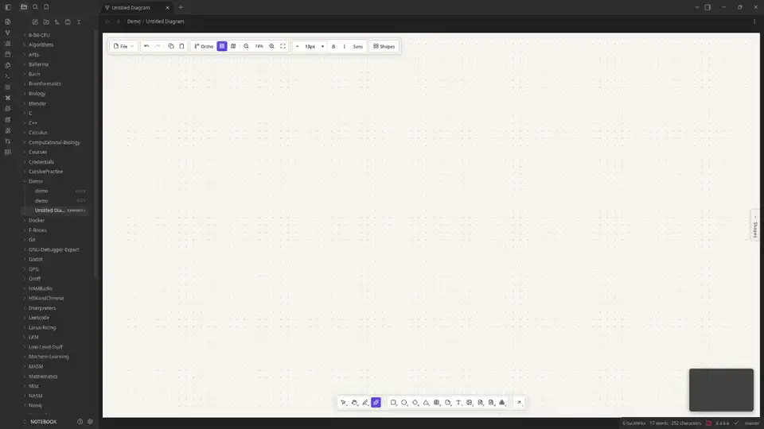
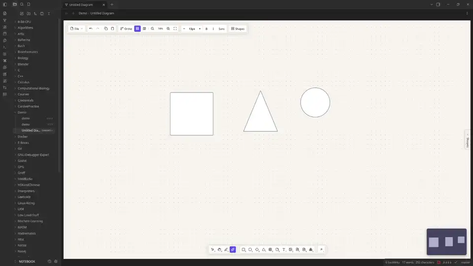
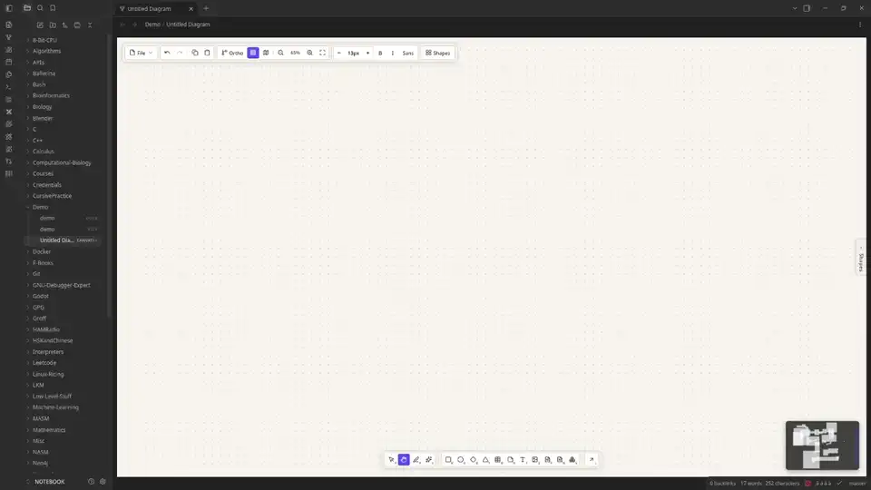
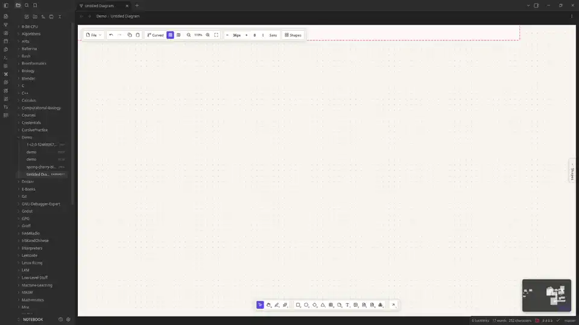
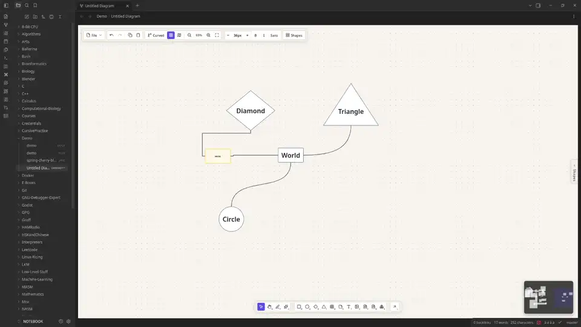
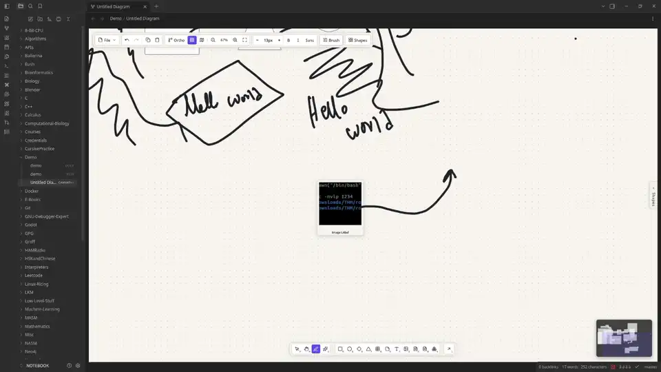
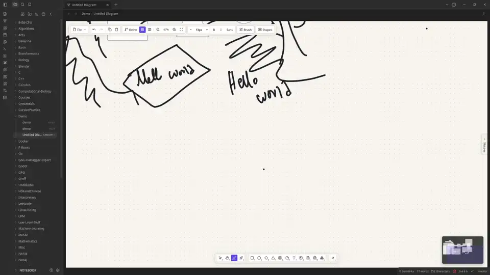
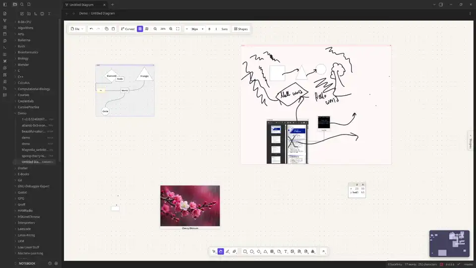

# Canvas++

  
  
  
  
  
  
  

> [!NOTE]
> **Version: `v2.2.2`**  
> An extensible, supercharged visual diagramming canvas for Obsidian. Sketch freehand, auto-detect geometric shapes, insert interactive tables, embed notes, PDFs, & images, create collapsible groups, and build flowcharts or formal UML architecture with native JSON Canvas compatibility.

---

  

## Overview

**Canvas++** is a high-performance, local-first visual diagramming canvas for [Obsidian](https://obsidian.md). Designed as an extensible supercharged upgrade to the default Obsidian Canvas, Canvas++ empowers you to think visually, sketch whiteboard ideas, build flowcharts, organize thoughts with cards & tables, and engineer detailed system diagrams—all directly within your vault.

Whether you are sketching a quick mental model, structuring complex research with embedded PDFs, designing a flowchart, or architecting software systems, Canvas++ combines the freedom of a digital whiteboard with the precision of structured modeling.

---

## Interactive Demos & Features

### 1. Instant Shape Enhancement & Auto-Detection
Sketch rough shapes with your mouse or stylus, and Canvas++ instantly enhances them into clean geometric shapes (rectangles, diamonds, ellipses, actors, circles, cylinders). An instant escape-hatch toast allows you to undo the conversion with one click if you prefer the raw hand-drawn stroke.

  

---

### 2. Natural Freehand Whiteboard Drawing
Draw smooth, responsive freehand sketches, quick annotations, and curvy lines without lag or jitter. Features sub-pixel smoothing, customizable brush widths, and adjustable stroke opacities for a natural whiteboard feel.

  

---

### 3. Rich Shapes, Smart Connectors & Flowcharts
Choose from an extensive library of geometric shapes, sticky notes, decision diamonds, and connectors. Connect any node with dynamic orthogonal, curved, or straight lines that feature automatic obstacle avoidance, waypoint editing, and customizable markers.

  

---

### 4. Interactive Structured Tables
Create and edit spreadsheet-style tables directly inside the canvas. Add or delete rows and columns with quick inline buttons, edit cell values directly, and organize data in structured formats right on your canvas.

  

---

### 5. Collapsible Groups & Visual Organization
Organize complex diagrams into logical clusters. Group multiple cards and shapes together, collapse them into compact cards when you want to reduce visual noise, and expand them whenever you need to dive into details.

  

---

### 6. Embedded PDF Documents & Multi-Page Viewer
Embed full multi-page PDF documents right onto the infinite canvas. Flip through pages, zoom into sections, and connect reference literature, slides, and datasheets side-by-side with your thoughts.

  

---

### 7. Vault Images & Visual Media Cards
Drag and drop images from your vault or search for assets directly from the canvas modal. Resize, position, and connect visual reference images, diagrams, and UI mockups.

  

---

### 8. Color Themes & Visual Customization
Personalize your workspace with curated color themes, pastel palettes, dark/light mode synchronization, customizable accent colors, and custom typography styling.

  

---

### 9. Software Engineering & UML Architecture Modeling
When you need formal technical specifications, Canvas++ provides comprehensive UML 2.x support:
- **Structure**: Class (with attribute/method compartments and visibility icons), Object, Package, Component, Composite Structure, Deployment, Profile.
- **Behavior**: Sequence (lifelines & activation bars), State Machine, Activity, Use Case, Communication, Interaction Overview, Timing.
- **Hardware Schematics**: Digital IC chips with directional I/O pins, multi-bit buses, and hierarchical sub-circuit drilldown.

  

---

## Core Advantages

- **JSON Canvas 1.0 Native**: Saved as `.canvuspp` files (with backward-compatible `.umlcanvas` support). Compatible with standard JSON Canvas viewers while storing rich visual and structural diagram data.
- **Infinite Canvas Performance**: Smooth pan and zoom (10% – 400%), smart alignment guides, viewport culling, and interactive minimap navigation.
- **AI Coding Agent Integration**: Built-in bidirectional file watcher (`.umlcanvas-patches/`) allows external AI coding agents (such as Google Antigravity) to safely inspect and patch diagrams without race conditions.
- **RAG Embedding Pipeline**: Export any diagram into structured, chunked markdown (`.umlcanvas-rag/<diagramId>.rag.md`) optimized for LLM context and vector embedding.
- **100% Local-First & Private**: Zero telemetry, zero external tracking, zero network requests. Everything lives exclusively in your vault.

---

## Installation

### From Obsidian Community Plugins
1. In Obsidian, open **Settings** > **Community plugins**.
2. Make sure **Restricted mode** is turned off.
3. Click **Browse** and search for `Canvas++`.
4. Click **Install**, then **Enable**.

### Beta Installation via BRAT (For Early Access)
1. Install [Obsidian42 - BRAT](https://github.com/TfTHacker/obsidian42-brat) from Community Plugins.
2. Go to **Settings** > **BRAT** > **Add Beta plugin**.
3. Enter `VishalRashmika/canvas-plus-plus`.
4. Click **Add Plugin** and enable **Canvas++** under **Community plugins**.

### Manual Installation
1. Download the release assets (`main.js`, `manifest.json`, `styles.css`) from the [Latest Release](https://github.com/VishalRashmika/canvas-plus-plus/releases) page.
2. In your Obsidian vault, navigate to `.obsidian/plugins/` (create the directory if it doesn't exist).
3. Create a folder named `canvas-plus-plus` and place the three files inside.
4. Reload Obsidian, go to **Settings** > **Community plugins**, and toggle on **Canvas++**.

---

## Keyboard & Mouse Controls

| Action | Shortcut |
| :--- | :--- |
| **Pan Canvas** | `Space + Drag` or `Middle Mouse Button Drag` |
| **Zoom In / Out** | `Mouse Wheel` (focuses at cursor position) |
| **Marquee Select** | `Click & Drag` on empty canvas |
| **Multi-Select** | `Shift + Click` or `Ctrl / Cmd + Click` on nodes/edges |
| **Move Selection** | `Click & Drag` selected nodes (with alignment snap) |
| **Resize Node** | `Drag` any bounding handle |
| **Connect Nodes** | `Click & Drag` from any port handle on a node |
| **Inline Text Edit** | `Double Click` any node title or edge label (or press `Enter` / `F2`) |
| **Group / Ungroup** | `Ctrl+G` / `Ctrl+Shift+G` |
| **Undo / Redo** | `Ctrl+Z` / `Ctrl+Shift+Z` (or `Cmd+Z` / `Cmd+Shift+Z`) |
| **Delete Selected** | `Delete` or `Backspace` |
| **Toggle Draw Mode** | Press `P` or click the **Pen** icon in the toolbar |
| **Auto Shape Detection**| Press `Shift + P` or click the **Sparkles** icon |

---

## Support

If Canvas++ helps your visual thinking, note-taking, and diagramming in Obsidian, consider supporting its maintenance and development:

  

---

## License

This project is licensed under the [GNU General Public License v3.0 (GPLv3)](LICENSE).
